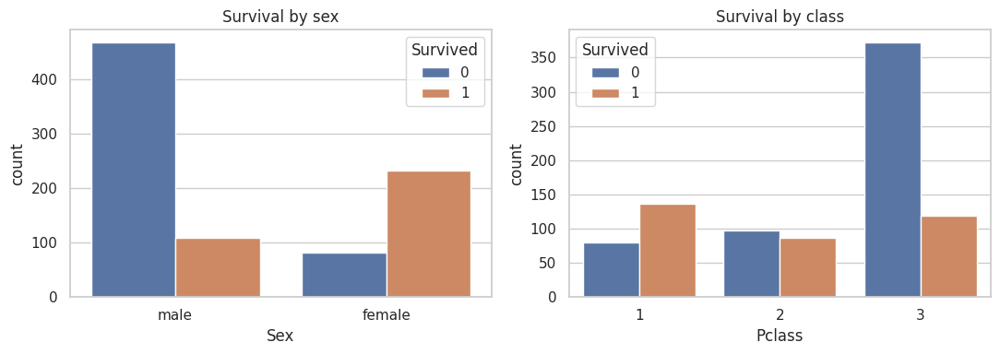
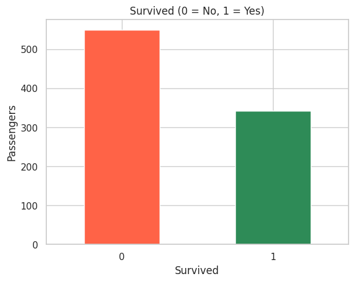
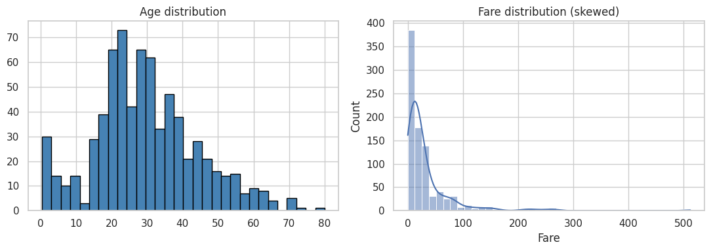
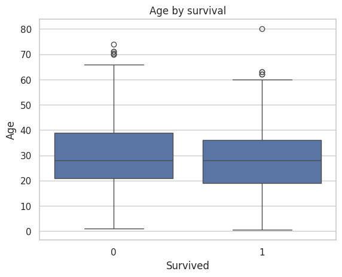
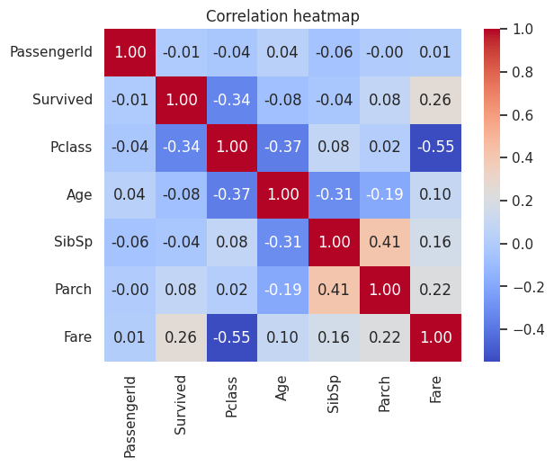
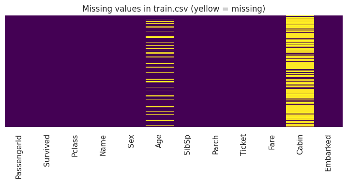
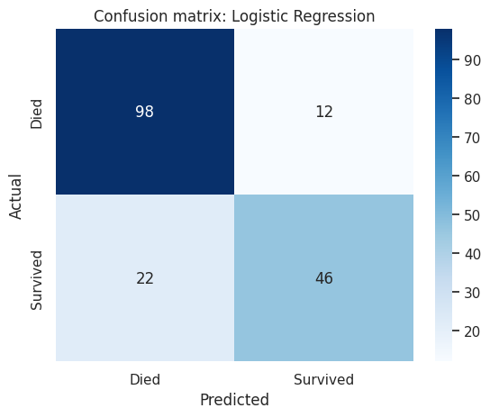
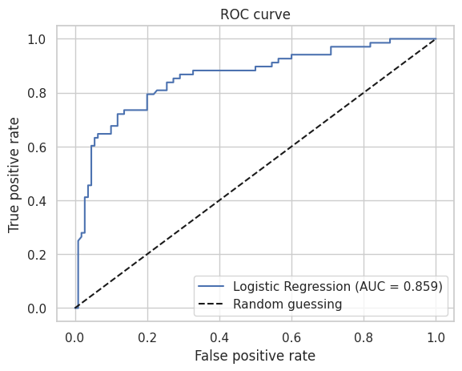
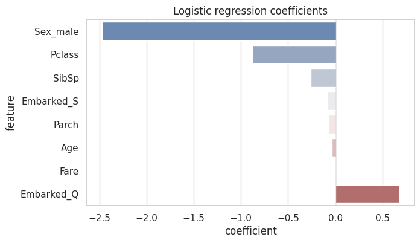

# Titanic Survival Prediction

[

An end-to-end machine learning project on the Kaggle
"Titanic - Machine Learning from Disaster" dataset, from raw CSV files to
evaluated models and predictions for unseen passengers.

## Overview

Two questions are explored:

1. **Classification:** Can we predict whether a passenger survived? (logistic regression)
2. **Regression:** Can we predict the fare a passenger paid? (linear regression)

## What this project covers

- **Exploratory data analysis** with matplotlib, seaborn and plotly to find the
  patterns behind survival (sex, class, age, fare)
- **Data cleaning:** dropping unusable columns and rows, and filling missing
  values with training-set means to avoid data leakage
- **Encoding:** one-hot encoding of categorical features
- **Feature engineering:** passenger title, family size and a "travelling alone"
  flag, compared against the plain feature set
- **Modeling:** logistic and linear regression with default hyperparameters
- **Evaluation:** accuracy against a majority-class baseline, confusion matrix,
  ROC/AUC, 5-fold cross-validation, and R², MAE and RMSE for regression
- **Reusable code:** one preprocessing function applied identically to the
  training and test data

## Key results

| Model | Task | Metric | Score |
|---|---|---|---|
| Baseline (always predicts "died") | Classification | Accuracy | 0.618 |
| Logistic Regression, plain features | Classification | 5-fold CV accuracy | 0.787 |
| Logistic Regression, engineered features | Classification | 5-fold CV accuracy | 0.814 |
| Logistic Regression | Classification | ROC AUC | 0.857 |
| Linear Regression | Fare prediction | R² | 0.347 |

## Exploratory analysis

Survival depended strongly on sex and passenger class.











## Data cleaning

Cabin (about 77% missing) was dropped, Age was filled with the training mean,
and the few missing Embarked and Fare values were handled individually.



## Model results







## What I learned

WRITE 3 TO 4 SENTENCES IN YOUR OWN WORDS. For example: what surprised you in
the data, whether the engineered features helped, and what you would try next.

## Limitations and next steps

- All models use default hyperparameters by design; tuning with GridSearchCV is a next step.
- Age was filled with the global mean; filling by title or class would likely be better.
- Fare is skewed, so a log transform could improve the regression.
- Tree-based models such as Random Forest could be compared against the linear ones.

## How to run

1. Click the **Open in Colab** badge at the top.
2. Run all cells (**Runtime → Run all**). The notebook loads the data directly from this repository.

To run it locally instead:

```bash
pip install -r requirements.txt
jupyter notebook titanic_analysis.ipynb
```

and change the data-loading cell to read the CSV files from your computer.

## Repository structure

```
titanic-survival-prediction/
├── README.md
├── titanic_analysis.ipynb
├── requirements.txt
├── .gitignore
├── LICENSE
├── raw_data/
│   ├── train.csv
│   ├── test.csv
│   └── gender_submission.csv
└── images/
```

## Data

Kaggle: [Titanic - Machine Learning from Disaster](https://www.kaggle.com/c/titanic).
The files are included here for convenience; please refer to Kaggle for the
dataset's terms of use.

## Tech stack

Python · pandas · NumPy · matplotlib · seaborn · plotly · scikit-learn · Google Colab

## License

MIT License. See [LICENSE](LICENSE).
